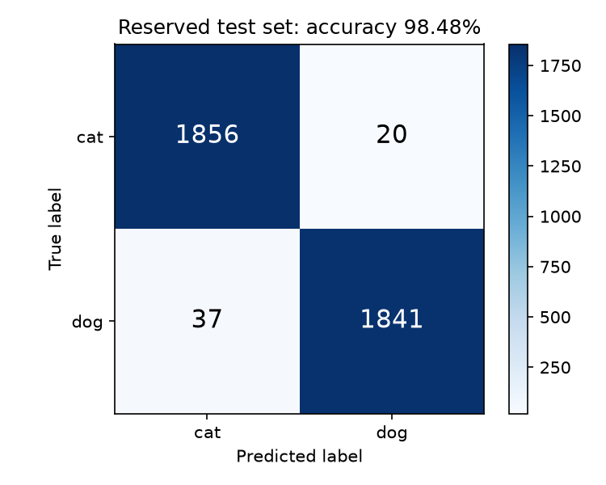
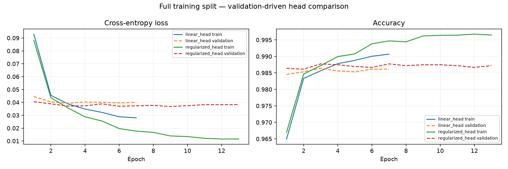
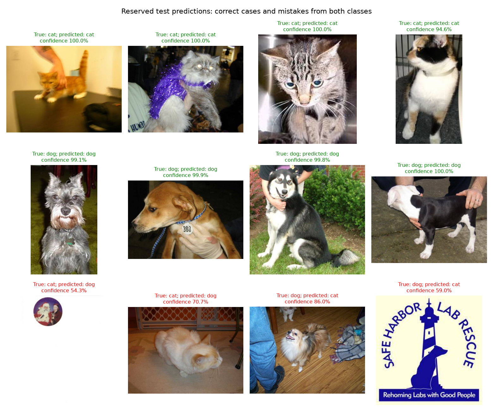

# Dogs vs Cats Image Classifier

A complete 4Geeks image-classification project: dataset inspection, leakage-aware splits, the provided VGG16-style baseline, full-data transfer-learning optimization, and a reserved-test evaluation.

## Final result

| Item | Result |
|---|---|
| Reserved test accuracy | **98.48%** |
| Test images | 3,754 |
| Test ROC AUC | 0.99881 |
| Selected classifier head | regularized_head |
| Full training photos | 17,498 |
| Training-only augmented views | 4,375 |
| Validation photos | 3,748 |
| Optimized backbone | MobileNetV2, ImageNet pretrained and frozen |
| Saved inference model | `models/final_classifier.keras` (9.8 MB) |



## What was trained

The assignment’s original VGG16-style architecture is implemented in `src/train_baseline.py`: 13 convolutions, five max pools, Flatten, Dense(4096), Dense(4096), and a two-class softmax. It uses 200x200 inputs consistently. Its two-epoch, 64-photo initial run was a pipeline check, not a full-data accuracy result. The 408 MB initial checkpoint remains local and is excluded from Git.

A measured two-CPU benchmark estimated roughly two hours for frozen VGG16 feature extraction, compared with roughly fifteen minutes for MobileNetV2. The full-data optimization therefore uses an efficient MobileNetV2 alternative; this architecture change is deliberate and is not presented as full-data training of the original VGG16 model. The convolutional backbone remains frozen, and the classification heads learn from all local training images. The VGG16 transfer-learning option is also implemented (`--backbone vgg16`) but was not run as the final experiment.

Two head configurations were compared on the same original/augmented feature vectors: a linear softmax classifier and a Dense(128)+Dropout(0.35)+softmax classifier. ModelCheckpoint, EarlyStopping, and ReduceLROnPlateau monitored validation loss. The head with the lowest full-validation log loss was selected **before** test access. No hyperparameter or decision-threshold changes used test results.



## Dataset and preprocessing

- Source: [4Geeks dogs-vs-cats archive](https://storage.googleapis.com/datascience-materials/dogs-vs-cats.zip), based on the Petfinder/Microsoft cats-and-dogs dataset.
- 25,000 labeled RGB photos: 12,500 cats and 12,500 dogs.
- All images passed Pillow verification, full decoding, and the TensorFlow loader check. macOS metadata companions are ignored.
- Seed 42; approximately 70/15/15 splits: 17,498 train, 3,748 validation, 3,754 test.
- Six exact duplicate photos are grouped by SHA-256; identical content cannot cross splits. The slight ratio differences preserve these groups.
- Batched on-demand decoding to 200x200 RGB and normalization to [0,1].
- One seeded augmented view for every fourth training record; validation/test images are never augmented.
- Frozen-backbone features are cached locally to avoid repeating convolutional inference every epoch.

## Start here

The executed **[`src/explore.ipynb`](src/explore.ipynb)** is the complete project report with dataset grids, split checks, baseline details, optimization, test metrics, mistakes, and a prediction example. Detailed earlier work is preserved in `01_environment_and_data.ipynb` and `02_preprocessing_and_initial_training.ipynb`.

## Install

Tested in Linux Codespaces with Python 3.13. Dependency versions are pinned in `requirements-image-classifier.txt`. No API key or database is needed.

```bash
python -m venv .venv
.venv/bin/python -m pip install -r requirements.txt
.venv/bin/python -m pip check
.venv/bin/python -m ipykernel install --user --name dogs-cats-classifier --display-name "Python (Dogs vs Cats)"
```

Select the **Python (Dogs vs Cats)** notebook kernel. The committed final model can predict a new image without downloading the training dataset.

## Predict an image

```bash
.venv/bin/python src/app.py --image /path/to/photo.jpg
```

The command handles decoding, resizing, and normalization and returns JSON with the predicted class, confidence, and both class probabilities. Direct model input must be float32 RGB 200x200 in [0,1]; the exported model contains the backbone-specific scaling. Labels are cat=0 and dog=1.

## Reproduce the fixed training/evaluation pipeline

```bash
.venv/bin/python src/prepare_data.py
.venv/bin/python src/build_splits.py
.venv/bin/python src/validate_pipeline.py
.venv/bin/python src/train_optimized.py --backbone mobilenet_v2 --reproduce
```

The `--reproduce` flag explicitly permits rerunning the same predefined pipeline when committed results already exist. Keep the test split reserved; do not use repeated test scores to tune a model. Feature caches are reused only when the split manifest and configuration match. Training/evaluation can take time on a CPU.

## Saved deliverables

- `models/final_classifier.keras`: portable inference model, reload checked.
- `reports/optimization_results.json` and `optimization_comparison.csv`: validation-only experiment comparison.
- `reports/test_metrics.json`: accuracy, class precision/recall/F1, ROC AUC, log loss, and confusion matrix.
- `reports/test_predictions.csv`: per-image test predictions.
- `reports/figures/`: image grids, preprocessing examples, learning curves, confusion matrix, and correct/incorrect predictions.
- `reports/final_model_metadata.json`: preprocessing contract, model checksum, and reload checks.
- `reports/final_verification.json`: final reproducibility and delivery checks.
- `MODEL_CARD.md`: intended use, training provenance, and limitations.

Raw images, downloaded archives, feature caches, `.venv`, `.env`, and intermediate checkpoints are excluded from Git. The final compact model and reports are included.

## Interpretation and limitations

These are actual results on the reserved split, not an accuracy guarantee for unrelated photos. The model always chooses cat or dog and cannot reject images containing neither. Softmax confidence is not a guarantee or a calibrated probability of correctness. ImageNet pretraining supplies prior visual knowledge; only the final heads were trained on this course dataset. Two head configurations are a limited optimization study, and the original small-subset baseline is not directly comparable to the full-validation experiments.



## References

- [4Geeks assignment](https://learn.4geeks.com/main-cohort/miami-ai-engineering-2/syllabus/models-training-rag-miami/project/image-classifier-project-tutorial?moduleId=3)
- [Keras MobileNet models](https://keras.io/api/applications/mobilenet/)
- [Keras ModelCheckpoint](https://keras.io/api/callbacks/model_checkpoint/)
- [Keras EarlyStopping](https://keras.io/api/callbacks/early_stopping/)
